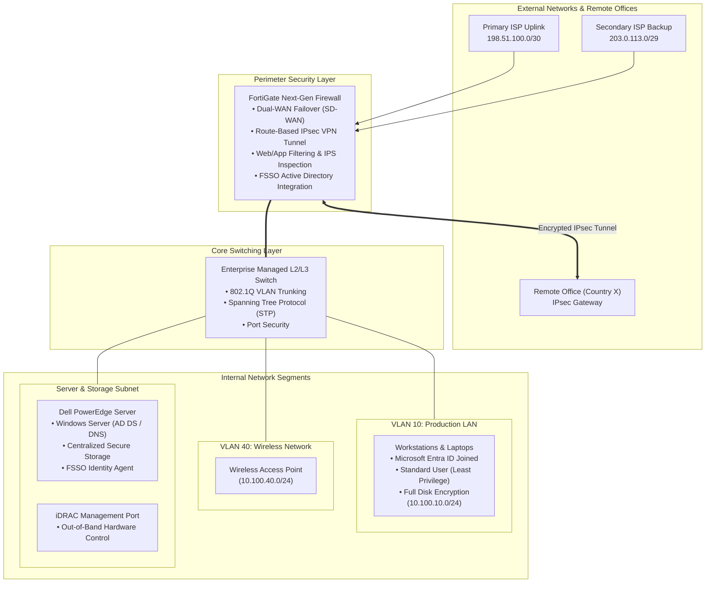

# Enterprise Network, Firewall & Server Setup

## Project Overview
Engineered and deployed a complete IT infrastructure and secure network for an enterprise delivery center.

---

##  Network Architecture Diagram

---

##  Key Highlights
- **Edge Security & Firewall:** Configured FortiGate NGFW with dual-ISP automatic failover and security filtering policies.
- **Site-to-Site VPN:** Built secure IPsec VPN tunnels connecting the delivery center to international offices (Country X).
- **Identity & Access Management:** Integrated Windows Active Directory with Fortinet Single Sign-On (FSSO) for role-based security.
- **Core Server & Storage:** Configured Dell PowerEdge server (Windows Server) hosting centralized storage with iDRAC remote management.
- **Endpoint Security:** Enforced Microsoft Entra ID, standard user privileges (least privilege), and full-disk encryption on client laptops.

---

##  Logical Network Scheme (Sanitized)

| Segment / VLAN | Description | Gateway / Subnet |
| :--- | :--- | :--- |
| **VLAN 10** | Production Workstations | `10.100.10.1/24` |
| **VLAN 40** | Wireless Network (WLAN) | `10.100.40.1/24` |
| **VLAN 99** | Server & iDRAC Management | `10.100.99.1/24` |
| **WAN 1** | Primary High-Speed ISP | `198.51.100.10/30` |
| **WAN 2** | Secondary Backup ISP | `203.0.113.42/29` |
